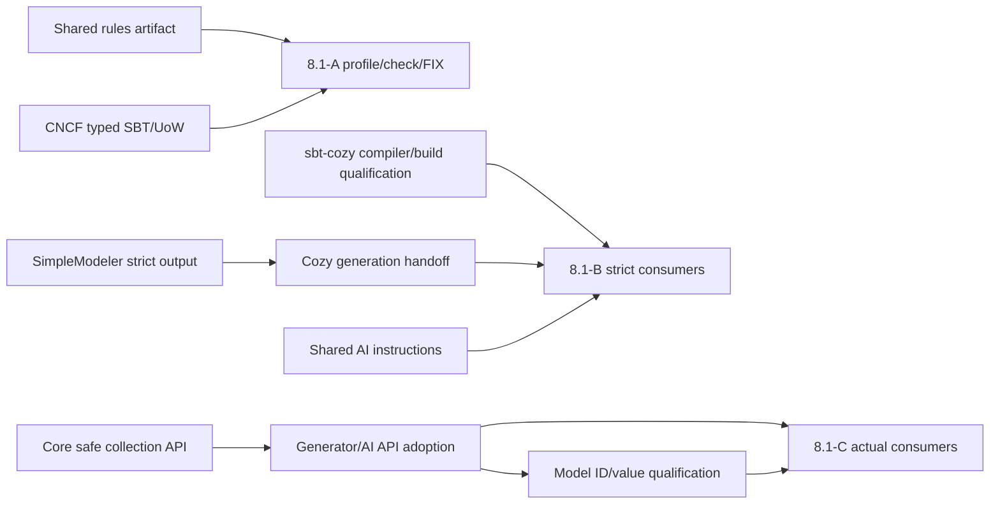

# Phase 8.1 cross-project delivery plan

Stage Status:
- Current status: OPEN
- Owner: sm-workflow development; each producer owns its local delivery
- Update rule: Record actual accepted handoffs and affected consumer evidence.
- Closure basis: Existing [Phase 8.1 checklist](phase-8.1-checklist.md), not an additional gate.

SLP-4 read-only integration observations and authored current-key native fixtures:
[bounded integration observations](../notes/phase8.1-producer-deliveries.md).
The bounded SLP-EXEC typed lint-input/provenance capability is delivered at CNCF
`bf1de998`; its actual producer checks/publication are reused. Consumer Action,
affected-scope reporting and delivery-projection integration are authored, NOT RUN.
Formal requester receipt/adoption and runtime installation remain unperformed;
no new consumer acceptance is claimed.

Planned: 2026-11-09
Execution: not started by this plan.
Parent: [Phase 8.1](phase-8.1.md)
Behavior: [Scala lint profiles](../spec/scala-lint-profiles.md)

SLP-1 source boundary: the [independent rule module](../../scala-lint-rules/README.md)
contains the initial rules, versioned profiles and compiler-input specifications.
The selected host is Scala 2.13.14 / Scalafix 0.12.1; analyzed input is Scala
3.3.8 with compiler-produced SemanticDB. SLP-1/SLP-2 were locally accepted at
`0c300ad9658045406fbba1c73e961749baa24947` through native checks and independent
review. This is not an accepted full SLP-RULES handoff. SLP-3 was locally accepted at `3e999f4800eba80f02d6b863a67bce800b5fa86f`
with the breaking history-key migration (no aliases), ordered additions/removals,
immutable effective snapshot and public scoped-exception/project differences. These supply A02/A06/A08 data foundations;
SLP-4 authors the per-call typed invocation, full-context affected-scope reporter
and actual-input retention; A08/A15 runtime/settings adoption awaits native
qualification and genuine consumer installation/adoption. All B/C acceptance remains owed. Root whole-source lint keeps its existing project configuration selection;
shared defaults are not activated there by this candidate. Full A01 normal-route
adoption remains owed until actual native qualification. No producer delivery or
checklist item is completed by source authorship or partial fixture proof.

## Roadmap position — 2026-11-11

Formerly Phase 6.12. The Phase order is 7 -> 8 -> 8.1 -> 9. The A/B/C capability
order below is internal to Phase 8.1. Producer-local plan identities remain
unchanged; old 6.12 references resolve through the relocation records. No
producer work or active Session is started by this scheduling decision.

## Ownership and delivery units

The IDs below identify bounded handoffs, not new Sessions or producer Phase
numbers. The bounded local SLP-1/SLP-2 acceptance above does not close the
cross-project handoffs below. They remain planned and unaccepted. Existing code
alone is inspection evidence, not qualification of the remaining requirements.

| Delivery | Producer and local plan | Handoff to Phase 8.1 | Required before |
| --- | --- | --- | --- |
| SLP-RULES | sm-workflow, SLP-1/SLP-2 | One reusable versioned Scalafix rule artifact, baseline/team resources, qualified Scala/SemanticDB matrix and diagnostics | A rule execution and adoption; CNCF build consumption |
| SLP-CORE | [goldenport-core](../../../goldenport-core/docs/phase/phase-4.md) | Receiver-type-preserving equality/identity collection API, actual imports/signatures and positive/negative evidence | C generated/AI API adoption; not A or independent B work |
| SLP-GEN | [SimpleModeler](../../../simple-modeler/docs/phase/phase-1.md) | Qualified Scala 3 output with strictEquality and bounded CanEqual; later Core API emission where actually needed | Cozy generation qualification; B/C generated-consumer acceptance |
| SLP-COZY | [Cozy](../../../cozy/docs/phase/phase-89.md) | Normal CML-to-generator integration, Cozy-owned Scala output coverage and a small generated compilation handoff | B/C end-to-end generated acceptance |
| SLP-MODEL | [SimpleModeling Model](../../../simplemodeling-model/docs/phase/phase-1.md) | Model-owned ID/value compatibility and representative library-target compilation against the accepted Core/generator delivery | Affected B/C model consumers only |
| SLP-BUILD | [sbt-cozy](../../../sbt-cozy/docs/phase/phase-1.md) | Qualified compiler-profile/build wiring and ordinary generation/check execution; implementation changes only for demonstrated gaps | B compiler-policy and relevant A/C build acceptance |
| SLP-AI | [development-workstation](../../../../development-workstation/docs/phase/phase-4.md) | Versioned AI coding instructions/templates, compiler/lint guidance and accepted Core imports; normal product distribution handoff | B AI-authored acceptance; C AI consumer adoption |
| SLP-EXEC | [CNCF](../../../goldenport-cncf/docs/phase/phase-122.md) | Existing typed SBT/UoW and resolved-configuration capability qualification, plus shared-rule build consumption | A normal validation/FIX result return; no new runtime API assumed |

Core owns generic equality/identity APIs; SimpleModeling Model owns its domain
types. Neither depends on sm-workflow, its profile resolver, its rule artifact
or CNCF at runtime. The rules artifact is a build tool, independently consumable
by CNCF; it must not require the sm-workflow application or its runtime. A
SemanticDB/Scalafix host cross-version is distinct from the Scala 3 code being
analyzed. Freeze the actual supported combination before accepting SLP-RULES.

## Dependency order and early handoffs

1. **Independent preparation:** SLP-RULES/profile resolution, Core API design,
   generator strict-output qualification, compiler-profile qualification and
   AI instruction preparation may progress independently under their owners.
   Existing `Scala3ClassGeneratorBase.section_import` already emits strictEquality;
   reuse it and test coverage instead of adding a parallel generator.
2. **A:** Deliver SLP-RULES and qualify SLP-EXEC/SLP-BUILD through normal check-only
   execution. CNCF may consume the rules artifact after that bounded delivery;
   it does not wait for Phase 8.1 closure. The rule package cannot import CNCF
   runtime code merely to recognize Consequence/Program symbols.
3. **B:** SimpleModeler hands off its strict-output subset before Cozy consumes
   it. SLP-BUILD and SLP-AI supply qualified compiler settings/instructions.
   Cozy returns actual generated compilation evidence; Model returns only
   affected model compatibility. B does not wait for Core collection extensions.
4. **C:** After SLP-CORE acceptance, SimpleModeler/Cozy and AI instructions adopt
   the actual API. Model qualifies its relevant ID/value use; sm-workflow maps
   these consumer results and lint advice to C01–C05. Before that handoff,
   proposed method names are not emitted, recommended as installed APIs or
   replaced by universal equality fallbacks.
5. **Final integration:** sm-workflow adopts each delivered revision through
   normal source/artifact selection, local publication where actually needed,
   normal validation/FIX and existing review/acceptance. Reuse applicable producer
   results; only changed integration conditions require additional verification.

The following are capability dependencies, not whole-Phase completion edges:

Early handoff scope is explicit: SLP-BUILD compiler settings are BUILD-01/02,
before its generated integration in BUILD-04; SLP-GEN strict output is GEN-01–03,
before Core-dependent GEN-04/05; SLP-EXEC execution capability is EXEC-01/02,
before shared-rule consumption in EXEC-03. SLP-COZY/SLP-MODEL/SLP-AI may likewise
deliver their B subset before C adoption. Accept each returned subset with its
actual scope and evidence; do not mark the remaining producer ledger complete.
These subset boundaries prevent a compiler-settings -> generator -> build
qualification cycle or a B -> Core-dependent C cycle.

No producer waits for all of 8.1; no generated consumer is made a prerequisite
for building its own generator. The Model consumer fixture is a selected target,
not a new runtime dependency from Core or a new generator-host dependency cycle.
For unavailable delivery, leave only affected acceptance items OPEN and continue
independent work. Do not report an unavailable producer as implemented.

## Handoff and evidence contract

Each producer returns its canonical checkout/revision, changed public surface
and imports/settings, selected artifact coordinates or source selection, actual
compiler/SemanticDB versions and scopes, focused results, independent review
disposition, publication status when required, and known limitations. An unchanged
provider may return a qualified no-change handoff with evidence. Documentation
or a successful publication alone is not acceptance. Use existing result records;
no new evidence registry, hashes or additional review loop is introduced.

Map acceptance without adding or completing checklist IDs:

| Existing criteria | Required handoffs |
| --- | --- |
| A01–A15 | SLP-RULES, SLP-EXEC, applicable SLP-BUILD; AI/config producers for the key rename |
| A16–A33 | SLP-RULES supported analysis and diagnostics, including structural AST/token checks; reuse qualified compiler/producer guarantees |
| B01 | SLP-GEN, SLP-COZY, SLP-AI; strictEquality and structural-braces/terminal-expression policy |
| B02–B03 | SLP-BUILD and producer-specific bounded CanEqual/strict compiler evidence |
| B04 | Actual generated and AI-authored consumption, affected SLP-MODEL compatibility |
| C01–C03 | SLP-CORE |
| C04–C05 | SLP-CORE plus actual SLP-GEN/SLP-COZY/SLP-AI and affected SLP-MODEL consumption |

### B01 producer boundaries

B01 needs active strictEquality and explicit structural braces in the selected
generated and AI-authored Scala 3 sources. SimpleModeler's shared
`Scala3ClassGeneratorBase.section_import` already supplies the import; preserve
that path. Its owner qualifies the emitted `given` implementations, including
ValueReader, nested collection readers and entity-persistence instances, and
repairs structural bodies at their emitting template. Positive generated
fixtures must demonstrate that those bodies use braces while ordinary terminal
implementation expressions remain permitted. Keep the Scala 2 generator host
and other backends unchanged.

Cozy owns the normal CML-to-SimpleModeler connection and the Scala sources it
appends independently. Its B01 handoff must identify selected Compile and Test
outputs, including applicable workflow/action-program, provided-API,
candidate-admission, failure-model, logical-UI and validation-metadata sources.
Qualification of the shared SimpleModeler base does not cover those independent
emitters. Check active imports and structural syntax on actual generated output
at the producer boundary; managed sources retain their generated classification.

Development-workstation owns the common AI instruction/template delivery and
its distribution handoff. Reference the authoritative ai-directive structural
policy and require an active strictEquality import in the selected Scala 3
source scope. Return representative authored-source evidence and the actual
distributed revision so sm-workflow can establish agreement at normal adoption.

The existing `ai/directive` selection and root `AGENTS.md`/`RULE.md` links are
the primary shared-rule path. A freshly selected authoring role must actually
read the selected linked rules before authoring; the presence of links or an
agent TOML alone does not establish that consumption. Keep normative text at
ai-directive. The current product and workstation skill/agent bundles do not
transport that repository, so installing either bundle alone does not adopt a
new shared-rule revision. Reconcile agent prompts only if qualification shows
that their existing repository-rule reading path is insufficient.

A task-private local selection of an isolated directive commit can qualify
authoring behavior without committing a consumer gitlink. Existing admitted
fixture paths and ordinary workspace/read bindings may select the exact policy
source as an authoring input; that preparatory selection does not require a new
tracked-source inventory. A missing host/read binding is a host/input dependency,
not permission to change a tracked path. Retain the actual rule consumption,
local source selection and its limitations with the authored-source evidence.
This is local qualification, not reproducible common distribution.
Before committing a consumer gitlink for normal adoption, its
exact directive commit must be available through the consumer's supported source
transport. Publication, product adoption and workstation adoption retain their
separate owners and effect authorities; no such effect follows from a local
source check or a dependency inventory.

For each B01 handoff, retain the selected producer/source or artifact revision,
actual generated or authored source scope, structural tree/token evidence and
applicable compilation results. Compilation alone does not qualify structural
braces. Reuse already qualified behavior where its conditions apply; remaining
B02/B03 compiler and comparison qualification and B04 consumer acceptance keep
their existing boundaries. Missing producer evidence leaves B01 open without
requiring whole producer-Phase closure or Core stage C delivery.

### B02/B03 early compiler handoff

SLP-B2 reuses the accepted B01 import/structural evidence from SimpleModeler
`365814a9` and Cozy `6feac334`, plus the authored-consumer source selection. Cozy's
16 selected Scala 3.3.8 Compile/Test scopes establish that bounded B01 output
inventory. They do not establish explicit-null, initialization or warning-policy
qualification; the full Workflow/FailureModel component-body exclusions remain.

The requester adopted the actual sbt-cozy BUILD-01/02 delivery at
`c978b1a1ae878edbdc6fa2d588228c6c4ecdf2de` through the retained
`slpb2-sbt-cozy-adoption-001/response.json` in the current Phase task. Its exact
settings and evidence are recorded in the
[consumer integration notes](../notes/phase8.1-producer-deliveries.md#slp-b2-compiler-policy-adoption--2026-11-20).
Ordinary project-level settings qualify Scala 3.3.8 JVM Compile/Test; no plugin
implementation or publication is required. The Scala 2.12.20 plugin host keeps
its existing options. BUILD-03/04 and actual generated consumer qualification
remain outside this early delivery.

SLP-B2 selects those options in the normal `scalaStrictAuthoring` project. Its
Compile sources own the actual authored comparison model; Test exclusively owns
`WorkflowStrictComparisonSpec.scala`, including diagnostic-specific distinct-ID
rejection and the retained `Vector.contains` limitation. Root aggregates the
project for ordinary compile/test, and both forms of fix-check compile its Test
scope and analyze its selected handwritten sources through existing Scalafix.
The new module uses ordinary ScalaTest discovery; the root's metadata inventory
and selection keep their existing root-source boundary. There is no root/Test
classpath dependency and the suite is not also compiled or run by root/Test.

This bounded consumer integration is authored **NOT RUN**. Runtime validation
must establish the actual Compile/Test options, sources, compiler result and
single suite execution. Deliberately rule-violating lint inputs and legacy mixed
application scopes have not been qualified for this policy. B03 cannot imply
package-wide compatibility; B3 retains the real generated/AI consumer adoption
work and the prior Workflow/FailureModel exclusions. No live Session or prior
successful result is changed by this build selection.

### B04 generated-consumer activation

The small B3 fixture uses explicitly selected strict-authoring Cozy library generation and
selects exactly the actual `CountryCode.scala` and `RegionCode.scala` sources.
The generated-type consumer specification covers same-type equality, cross-type
direct/predicate rejection and the precompiled contains limitation under the
unchanged B2 ten-option compiler policy. The prior three-file assertion is
corrected because `CompositeStateMachineAbi.scala` is emitted by the CNCF branch,
not this library route. Existing B1 ABI evidence stays with B1. B2 native receipt
`34c1be2c560461e9905745f2e06dc533:ordered-validation:3611:validation` and accepted
commit `8502548d` remain the authored-consumer baseline.

The original Cozy activation return records local publication and a successful
library bridge probe using Cozy `6feac334` with SimpleModeler `365814a9`.
That Cozy DelegateTask remains at `Human` over the unsupported ABI demand and
issued no `ReturnReady`; its evidence supplies no fresh CNCF ABI qualification.
Native B3 compilation then exposed 36 unused-import/private-member errors in
the two generated values under the unchanged strict compiler options.

The separate bounded SimpleModeler repair returned `ReturnReady` at generation
2 for `df7d8b5f`, tree `3d518730cbaf7542a159cf9e85dd70f3fc4c9a65`.
Its native Compile and five focused `Scala3StrictStructureGenerationSpec` tests
succeeded, independent re-review accepted the repair and local publication
exited 0. The repair reduces unused emission for plain single-string library
values while preserving used structured/create-purpose helpers and B1 contracts.
The requester received the return and selected the task-private Ivy
`org.simplemodeling:simplemodeler_2.12:1.1.27-SNAPSHOT` JAR. It replaces only
the old SimpleModeler source classes in the activation classpath, retaining
Cozy `6feac334` / `org.simplemodeling:cozy_2.12:0.3.3-SNAPSHOT` and other entries.
See the [integration record](../notes/phase8.1-producer-deliveries.md#slp-b3-representative-consumer-preparation--2026-11-20)
for the artifact digest and retained return/selection evidence.

The prior candidate passed full native compile/test/fix-check in receipt
`34c1be2c560461e9905745f2e06dc533:ordered-validation:3676:validation`,
including ten successful strict cases across the generated and authored suites,
each executed once. Issue-17 retains that result and addresses subsequent use:
ordinary root builds now default to the seven authored B2 cases without invoking
the B04 generator, whether a local Cozy selection is present or absent.

Dedicated qualification sets module configuration
`qualification.strict_generated: true`, or supplies
`SM_WORKFLOW_STRICT_GENERATED_QUALIFICATION=true` to the selected native program.
The environment override accepts only literal `true` or `false`; otherwise the
module Boolean defaults to false. Qualification requires the existing
`generation.delegate.project_dir` selection and uses sbt-cozy's project
validation and `--runtime-dev-dir` route. Prepare a real Cozy `6feac334` local
project whose existing launcher classpath selects the verified SimpleModeler
`df7d8b5f` / `1.1.27-SNAPSHOT` JAR, with the other activation dependencies
retained. The [reproduction instructions](../notes/phase8.1-producer-deliveries.md#explicit-generated-qualification-after-issue-17)
record the exact artifact digest and module configuration; no tracked task-local
path or alternate resolver is required. Ambient `SBT_COZY_PROJECT_DIR` stays
absent from the full root CAR build.

Explicit mode bypasses unchanged-generation caching, requires both generated
files exactly once, and includes the generated Test source once alongside the
seven authored cases under the same ten flags. The dynamic task branch and
disabled unused library ABI resource generator prevent default builds from
triggering qualification. Absent selection or artifacts cannot silently pass
explicit qualification. Native default compile and explicit fresh generated
test/fix-check for this issue-17 candidate remain pending, including generated
inventory/provenance and classpath/options evidence. Compiler compatibility
requires actual selected diagnostics; no generated warning bypass is assumed.
Prior B1 evidence remains applicable to its actual source selection. Full
Workflow/FailureModel bodies, historical settings and Core stage C retain their
separate boundaries.

All plans preserve current priorities, Goals, Sessions, base, accepted results,
history, repair counts and unrelated tracked/untracked work. They start no
implementation, chat dispatch, workflow operation, build, publication, commit or
synchronization. CNCF implementation remains with `CNCF開発` in canonical
`goldenport-cncf` main, not `sm-workflow-dev開発` or a newly created worktree.
