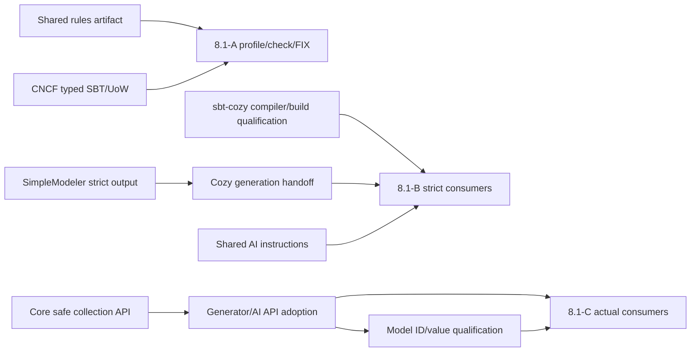

# Phase 8.1 cross-project delivery plan

Stage Status:
- Current status: OPEN
- Owner: sm-workflow development; each producer owns its local delivery
- Update rule: Record actual accepted handoffs and affected consumer evidence.
- Closure basis: Existing [Phase 8.1 checklist](phase-8.1-checklist.md), not an additional gate.

Planned: 2026-11-09
Execution: not started by this plan.
Parent: [Phase 8.1](phase-8.1.md)
Behavior: [Scala lint profiles](../spec/scala-lint-profiles.md)

## Roadmap position — 2026-11-11

Formerly Phase 6.12. The Phase order is 7 -> 8 -> 8.1 -> 9. The A/B/C capability
order below is internal to Phase 8.1. Producer-local plan identities remain
unchanged; old 6.12 references resolve through the relocation records. No
producer work or active Session is started by this scheduling decision.

## Ownership and delivery units

The IDs below identify bounded handoffs, not new Sessions or producer Phase
numbers. All handoffs are planned and unaccepted. Existing code is inspection
evidence only; it is not qualification of these new requirements.

| Delivery | Producer and local plan | Handoff to Phase 8.1 | Required before |
| --- | --- | --- | --- |
| SLP-RULES | sm-workflow, SLP-1/SLP-2 | One reusable versioned Scalafix rule artifact, baseline/team resources, qualified Scala/SemanticDB matrix and diagnostics | A rule execution and adoption; CNCF build consumption |
| SLP-CORE | [goldenport-core](../../../goldenport-core/docs/phase/phase-4.md) | Receiver-type-preserving equality/identity collection API, actual imports/signatures and positive/negative evidence | C generated/AI API adoption; not A or independent B work |
| SLP-GEN | [SimpleModeler](../../../simple-modeler/docs/phase/phase-1.md) | Qualified Scala 3 output with strictEquality and bounded CanEqual; later Core API emission where actually needed | Cozy generation qualification; B/C generated-consumer acceptance |
| SLP-COZY | [Cozy](../../../cozy/docs/phase/phase-89.md) | Normal CML-to-generator integration, Cozy-owned Scala output coverage and a small generated compilation handoff | B/C end-to-end generated acceptance |
| SLP-MODEL | [SimpleModeling Model](../../../simplemodeling-model/docs/phase/phase-1.md) | Model-owned ID/value compatibility and representative library-target compilation against the accepted Core/generator delivery | Affected B/C model consumers only |
| SLP-BUILD | [sbt-cozy](../../../sbt-cozy/docs/phase/phase-1.md) | Qualified compiler-profile/build wiring and ordinary generation/check execution; implementation changes only for demonstrated gaps | B compiler-policy and relevant A/C build acceptance |
| SLP-AI | [development-workstation](../../../../development-workstation/docs/phase/phase-4.md) | Versioned AI coding instructions/templates, compiler/lint guidance and accepted Core imports; normal product distribution handoff | B AI-authored acceptance; C AI consumer adoption |
| SLP-EXEC | [CNCF](../../../goldenport-cncf/docs/phase/phase-122.md) | Existing typed SBT/UoW and resolved-configuration capability qualification, plus shared-rule build consumption | A normal validation/FIX result return; no new runtime API assumed |

Core owns generic equality/identity APIs; SimpleModeling Model owns its domain
types. Neither depends on sm-workflow, its profile resolver, its rule artifact
or CNCF at runtime. The rules artifact is a build tool, independently consumable
by CNCF; it must not require the sm-workflow application or its runtime. A
SemanticDB/Scalafix host cross-version is distinct from the Scala 3 code being
analyzed. Freeze the actual supported combination before accepting SLP-RULES.

## Dependency order and early handoffs

1. **Independent preparation:** SLP-RULES/profile resolution, Core API design,
   generator strict-output qualification, compiler-profile qualification and
   AI instruction preparation may progress independently under their owners.
   Existing `Scala3ClassGeneratorBase.section_import` already emits strictEquality;
   reuse it and test coverage instead of adding a parallel generator.
2. **A:** Deliver SLP-RULES and qualify SLP-EXEC/SLP-BUILD through normal check-only
   execution. CNCF may consume the rules artifact after that bounded delivery;
   it does not wait for Phase 8.1 closure. The rule package cannot import CNCF
   runtime code merely to recognize Consequence/Program symbols.
3. **B:** SimpleModeler hands off its strict-output subset before Cozy consumes
   it. SLP-BUILD and SLP-AI supply qualified compiler settings/instructions.
   Cozy returns actual generated compilation evidence; Model returns only
   affected model compatibility. B does not wait for Core collection extensions.
4. **C:** After SLP-CORE acceptance, SimpleModeler/Cozy and AI instructions adopt
   the actual API. Model qualifies its relevant ID/value use; sm-workflow maps
   these consumer results and lint advice to C01–C05. Before that handoff,
   proposed method names are not emitted, recommended as installed APIs or
   replaced by universal equality fallbacks.
5. **Final integration:** sm-workflow adopts each delivered revision through
   normal source/artifact selection, local publication where actually needed,
   normal validation/FIX and existing review/acceptance. Reuse applicable producer
   results; only changed integration conditions require additional verification.

The following are capability dependencies, not whole-Phase completion edges:

Early handoff scope is explicit: SLP-BUILD compiler settings are BUILD-01/02,
before its generated integration in BUILD-04; SLP-GEN strict output is GEN-01–03,
before Core-dependent GEN-04/05; SLP-EXEC execution capability is EXEC-01/02,
before shared-rule consumption in EXEC-03. SLP-COZY/SLP-MODEL/SLP-AI may likewise
deliver their B subset before C adoption. Accept each returned subset with its
actual scope and evidence; do not mark the remaining producer ledger complete.
These subset boundaries prevent a compiler-settings -> generator -> build
qualification cycle or a B -> Core-dependent C cycle.

No producer waits for all of 8.1; no generated consumer is made a prerequisite
for building its own generator. The Model consumer fixture is a selected target,
not a new runtime dependency from Core or a new generator-host dependency cycle.
For unavailable delivery, leave only affected acceptance items OPEN and continue
independent work. Do not report an unavailable producer as implemented.

## Handoff and evidence contract

Each producer returns its canonical checkout/revision, changed public surface
and imports/settings, selected artifact coordinates or source selection, actual
compiler/SemanticDB versions and scopes, focused results, independent review
disposition, publication status when required, and known limitations. An unchanged
provider may return a qualified no-change handoff with evidence. Documentation
or a successful publication alone is not acceptance. Use existing result records;
no new evidence registry, hashes or additional review loop is introduced.

Map acceptance without adding or completing checklist IDs:

| Existing criteria | Required handoffs |
| --- | --- |
| A01–A15 | SLP-RULES, SLP-EXEC, applicable SLP-BUILD; AI/config producers for the key rename |
| A16–A33 | SLP-RULES supported analysis and diagnostics, including structural AST/token checks; reuse qualified compiler/producer guarantees |
| B01 | SLP-GEN, SLP-COZY, SLP-AI; strictEquality and structural-braces/terminal-expression policy |
| B02–B03 | SLP-BUILD and producer-specific bounded CanEqual/strict compiler evidence |
| B04 | Actual generated and AI-authored consumption, affected SLP-MODEL compatibility |
| C01–C03 | SLP-CORE |
| C04–C05 | SLP-CORE plus actual SLP-GEN/SLP-COZY/SLP-AI and affected SLP-MODEL consumption |

All plans preserve current priorities, Goals, Sessions, base, accepted results,
history, repair counts and unrelated tracked/untracked work. They start no
implementation, chat dispatch, workflow operation, build, publication, commit or
synchronization. CNCF implementation remains with `CNCF開発` in canonical
`goldenport-cncf` main, not `sm-workflow-dev開発` or a newly created worktree.
